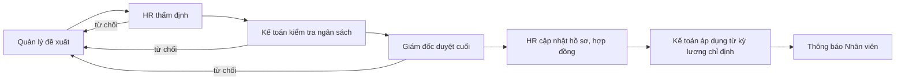
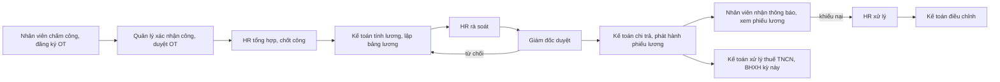
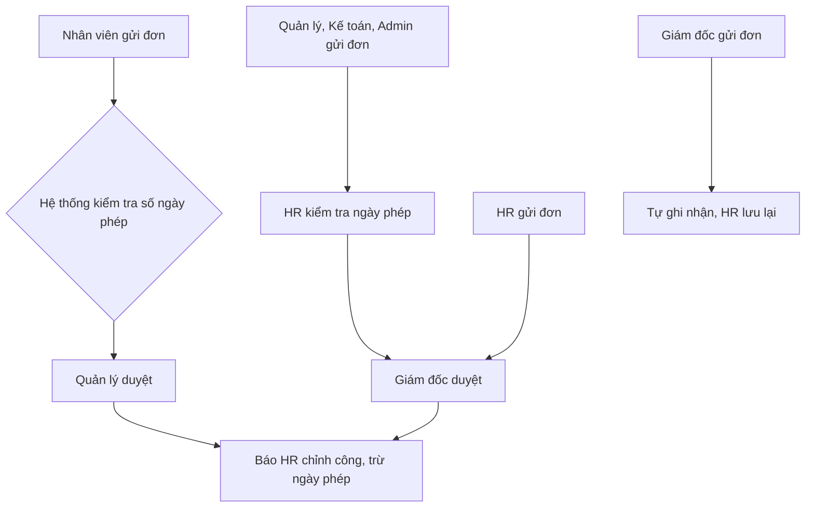
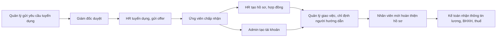
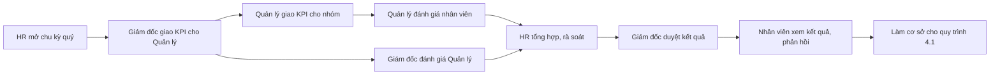
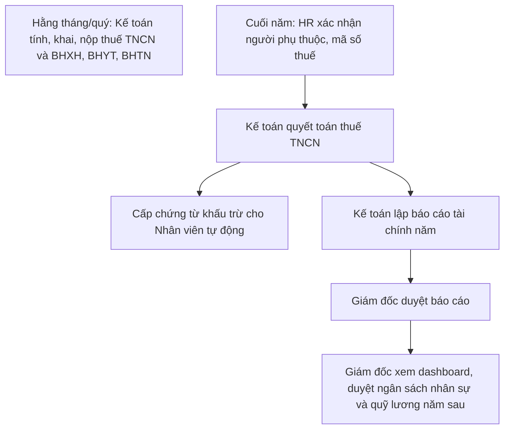
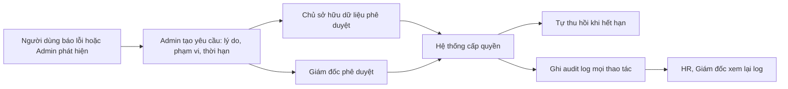

# PeopleOS — Vai trò và quy trình nghiệp vụ

> Phiên bản: 1.1 (khớp với code đã triển khai) · Phạm vi: 6 vai trò, cấu trúc quản lý **một tầng**, mỗi người **đúng một vai trò chính**.

## 1. Nguyên tắc chung

- 6 vai trò: **Nhân viên, Quản lý, HR, Giám đốc, Kế toán, Admin**.
- Mỗi tài khoản chỉ có **một vai trò chính**. Mọi tài khoản đều có thêm quyền **tự phục vụ** như Nhân viên (xem phiếu lương, xin nghỉ phép... của chính mình).
- Cấu trúc một tầng: Nhân viên → Quản lý → Giám đốc. HR, Kế toán, Admin báo cáo trực tiếp cho Giám đốc.
- Không ai được tự duyệt yêu cầu của chính mình.
- Admin **không xem trực tiếp** dữ liệu nhạy cảm (lương, hợp đồng, BHXH).
- Mọi thao tác nhạy cảm đều ghi **audit log** bất biến.

### Khóa vai trò trong hệ thống

| Vai trò | Khóa (Keycloak, JWT, Hasura, BFF) |
|---|---|
| Nhân viên | `employee` |
| Quản lý | `manager` |
| HR | `hr` |
| Giám đốc | `director` |
| Kế toán | `accountant` |
| Admin | **`sysadmin`** |

**Lưu ý bảo mật:** Admin dùng khóa `sysadmin`, **không** dùng `admin`. Trong Hasura, vai trò tên `admin` là siêu quyền (bỏ qua mọi phân quyền), nếu dùng thì Admin kỹ thuật sẽ đọc được lương và hợp đồng. Nhãn hiển thị trên giao diện vẫn là "Admin".

## 2. Công việc từng vai trò

### 2.1 Nhân viên
- Xem và cập nhật hồ sơ cá nhân (liên hệ, tài khoản ngân hàng, người phụ thuộc)
- Xem hợp đồng lao động của mình
- Xem phiếu lương hằng tháng, khiếu nại phiếu lương
- Xem thông tin BHXH, BHYT, BHTN của mình
- Xin nghỉ phép, theo dõi số ngày phép còn lại
- Xem chấm công, đăng ký làm thêm giờ (OT)
- Xem KPI và kết quả đánh giá của mình, gửi phản hồi
- Gửi yêu cầu tạm ứng, thanh toán chi phí, hoàn ứng
- Hỏi đáp chatbot AI (luật lao động, BHXH, thuế TNCN)
- Nhận thông báo realtime
- Tải chứng từ: giấy xác nhận lương (cần HR duyệt), chứng từ khấu trừ thuế TNCN và bảng thu nhập năm (tự động)

### 2.2 Quản lý
Toàn bộ quyền của Nhân viên, thêm:
- Xem danh sách và hồ sơ cơ bản nhân viên trong nhóm (không xem lương chi tiết)
- Duyệt/từ chối nghỉ phép của nhóm, báo HR chỉnh công
- Duyệt OT, xác nhận chấm công của nhóm
- Đề xuất tăng lương, thưởng, thăng chức (gửi HR)
- Giao KPI và đánh giá hiệu suất nhân viên trong nhóm
- Gửi yêu cầu tuyển dụng
- Tham gia onboarding: giao việc, chỉ định người hướng dẫn
- Xác nhận đề xuất nghỉ việc của nhân viên trong nhóm
- Xem báo cáo nhóm (đi làm, nghỉ phép, OT, tiến độ KPI)
- Duyệt tạm ứng/chi phí cấp 1 của nhóm

### 2.3 HR
Toàn bộ quyền của Nhân viên, thêm:
- Quản lý hồ sơ toàn bộ nhân viên
- Quản lý hợp đồng (soạn, gia hạn, chấm dứt, nhắc hết hạn)
- Onboarding: tạo hồ sơ, hợp đồng, checklist nhận việc
- Offboarding: kiểm tra thời gian báo trước, bàn giao, chấm dứt hợp đồng
- Tuyển dụng: đăng tin, theo dõi ứng viên, phỏng vấn, gửi offer
- Quản lý chính sách nghỉ phép, ngày lễ, ca làm việc; tổng hợp và chốt công cuối tháng
- Thẩm định đề xuất tăng lương/thưởng/thăng chức
- Rà soát bảng lương (đối chiếu hợp đồng, phụ cấp)
- Quản lý cơ cấu tổ chức (phòng ban, chức danh, thang bảng lương)
- Mở và tổng hợp chu kỳ đánh giá hiệu suất (theo quý)
- Duyệt giấy xác nhận lương/xác nhận công tác
- Xác nhận dữ liệu người phụ thuộc, mã số thuế trước quyết toán
- Cập nhật cơ sở tri thức cho chatbot AI
- Báo cáo nhân sự (biến động, tỷ lệ nghỉ việc, nghỉ phép)
- **Không** tính lương và chi trả

### 2.4 Giám đốc
Toàn bộ quyền của Nhân viên, thêm:
- Duyệt cuối đề xuất tăng lương/thưởng/thăng chức
- Duyệt cuối bảng lương hằng tháng
- Duyệt yêu cầu tuyển dụng và offer
- Duyệt ngân sách nhân sự và quỹ lương
- Dashboard điều hành: headcount, chi phí lương, biến động nhân sự, ngân sách so với thực tế
- Giao KPI và đánh giá Quản lý; duyệt kết quả đánh giá
- Duyệt nghỉ phép, tạm ứng, chi phí của Quản lý, HR, Kế toán, Admin
- Duyệt báo cáo tài chính năm
- Duyệt quyết định nhân sự lớn (bổ nhiệm, miễn nhiệm, chấm dứt hợp đồng)
- Xem báo cáo tổng hợp toàn công ty (không xem từng phiếu lương cá nhân)
- Phê duyệt yêu cầu cấp quyền tạm thời

### 2.5 Kế toán
Toàn bộ quyền của Nhân viên, thêm:
- Tính lương hằng tháng từ dữ liệu công HR đã chốt
- Lập bảng lương gửi duyệt; chi trả lương, phát hành phiếu lương
- Thuế TNCN: tính, khai báo, quyết toán, cấp chứng từ khấu trừ
- BHXH, BHYT, BHTN: tính, khai báo, nộp
- Xử lý tạm ứng, hoàn ứng, thanh toán chi phí
- Kiểm tra ngân sách khi duyệt đề xuất tăng lương/thưởng
- Lập báo cáo tài chính năm
- Báo cáo chi phí lương theo phòng ban, theo tháng
- Cập nhật thang bảng lương, tỷ lệ bảo hiểm, biểu thuế
- Phê duyệt cấp quyền tạm thời đối với dữ liệu lương (vai trò chủ sở hữu dữ liệu)

### 2.6 Admin
Toàn bộ quyền của Nhân viên, thêm:
- Quản lý tài khoản (tạo, khóa, mở khóa, đặt lại mật khẩu) qua Keycloak
- Gán/thu hồi vai trò, quản lý ma trận quyền (RBAC)
- Tạo yêu cầu cấp quyền tạm thời (tự thu hồi khi hết hạn)
- Xem và tìm kiếm audit log
- Cấu hình hệ thống, tích hợp (ngân hàng, email)
- Quản lý workflow n8n (theo dõi lỗi, chạy lại)
- Giám sát hệ thống, backup và khôi phục
- Quản lý quét mã độc (ClamAV), xử lý file cách ly
- Quản lý mô hình AI và kho tri thức ở mức kỹ thuật (Ollama, Qdrant), không xem nội dung dữ liệu cá nhân
- Quản lý nhật ký truy xuất nguồn gốc dữ liệu (data lineage)

## 3. Ma trận quyền (RBAC)

Ký hiệu: **C** tạo · **R** xem · **U** sửa · **A** duyệt · **S** chỉ của bản thân · **T** chỉ nhóm mình · **—** không có quyền

| Tài nguyên | Nhân viên | Quản lý | HR | Giám đốc | Kế toán | Admin |
|---|---|---|---|---|---|---|
| Hồ sơ cá nhân | R,U (S) | R (T, cơ bản) | C,R,U (tất cả) | R (tổng hợp) | R (phần thuế/BH) | — |
| Hợp đồng lao động | R (S) | — | C,R,U | R (tổng hợp) | R | — |
| Phiếu lương | R (S) | — | R (rà soát) | R (tổng hợp) | C,R,U | — |
| Bảng lương tháng | — | — | R, rà soát | A | C,R,U | — |
| Chấm công / OT | R,C (S) | A (T) | R,U, chốt công | R | R | — |
| Nghỉ phép | C,R (S) | A (T) | R,U (trừ phép) | A (QL, HR, KT, Admin) | — | — |
| Đề xuất lương/thưởng/thăng chức | R (S, kết quả) | C | Thẩm định | A (cuối) | Kiểm ngân sách | — |
| Tuyển dụng / offer | — | C (yêu cầu) | C,R,U | A | — | — |
| KPI / đánh giá | R (S), phản hồi | C,U (T) | Mở chu kỳ, tổng hợp | A, đánh giá QL | — | — |
| Tạm ứng / chi phí | C (S) | A cấp 1 (T) | — | A cấp 1 (QL, HR, KT, Admin); A cấp 2 (> 20 triệu) | Kiểm tra, chi | — |
| Thuế TNCN / BHXH | R (S) | — | Xác nhận người phụ thuộc | R (tổng hợp) | C,R,U | — |
| Báo cáo tài chính năm | — | — | — | A | C,R,U | — |
| Ngân sách / quỹ lương | — | — | R | A | R | — |
| Dashboard điều hành | — | R (nhóm) | R (nhân sự) | R (toàn công ty) | R (chi phí lương) | — |
| Tài khoản & vai trò | — | — | Yêu cầu tạo (onboarding) | — | — | C,R,U |
| Cấp quyền tạm thời | — | — | A (dữ liệu hồ sơ) | A | A (dữ liệu lương) | C (yêu cầu) |
| Audit log | — | — | R (xem lại) | R | — | R,tìm kiếm |
| Cấu hình, n8n, backup, ClamAV, AI kỹ thuật | — | — | Kho tri thức (nội dung) | — | — | C,R,U |

**Quy tắc kiểm soát:**
1. Không tự duyệt yêu cầu của chính mình.
2. Admin không có quyền đọc dữ liệu lương, hợp đồng, BHXH; chỉ có quyền tạm thời qua quy trình 9.
3. Quản lý chỉ thấy dữ liệu của nhân viên trong nhóm mình.
4. Giám đốc chỉ xem tổng hợp, không xem từng phiếu lương cá nhân.
5. Bảng hồ sơ nhân viên (`employees`): Giám đốc và Kế toán đọc đủ cột (Kế toán cần mã số thuế, số BHXH/BHYT và người phụ thuộc để làm lương, thuế; Hasura chỉ cho một bộ cột mỗi vai trò nên không thể vừa ẩn cột của người khác vừa cho đọc cột của chính mình). Quản lý chỉ thấy nhóm mình, Admin chỉ thấy hồ sơ của chính mình.

## 4. Quy trình nghiệp vụ

### 4.1 Đề xuất tăng lương / thưởng / thăng chức

Từ chối ở bất kỳ bước nào: quay về Quản lý kèm lý do.

### 4.2 Tính lương và chi trả hằng tháng

**Triển khai:** HR chốt công (tạo kỳ lương) → Kế toán tính lương (các phiếu ở trạng thái nháp, chỉ HR và Kế toán thấy) → HR rà soát → Giám đốc duyệt → Kế toán chi trả (phiếu chuyển `paid`, ghi bảo hiểm tháng, thông báo từng nhân viên). HR hoặc Giám đốc từ chối thì kỳ lương quay về Kế toán kèm lý do. Nhân viên khiếu nại phiếu lương đã phát hành (mỗi phiếu một khiếu nại đang xử lý): HR chuyển Kế toán hoặc từ chối; Kế toán điều chỉnh tiền làm thêm giờ/thưởng, hệ thống tính lại phiếu và bảo hiểm tháng, nhân viên nhận thông báo. Công thức tính (bảo hiểm, giảm trừ gia cảnh, biểu thuế lũy tiến, trần đóng) là bản Java của `peopleos_shared.payroll` và được đối chiếu bằng test với các ca của bản Python.

**Giới hạn:** hệ thống chưa có bảng chấm công chi tiết, nên tiền làm thêm giờ và thưởng do Kế toán nhập theo số liệu HR đã chốt; lương tính đủ tháng cho mọi nhân viên đang làm việc có hợp đồng hiệu lực (chưa tính theo ngày công thực tế). Không cho chốt công một tháng đã có phiếu lương đã chi trả.

### 4.3 Nghỉ phép

| Người xin nghỉ | Chuỗi duyệt |
|---|---|
| Nhân viên | Quản lý duyệt → báo HR chỉnh công |
| Quản lý, Kế toán, Admin | HR kiểm tra ngày phép → Giám đốc duyệt |
| HR | Giám đốc duyệt trực tiếp |
| Giám đốc | Tự ghi nhận, HR lưu lại |

### 4.4 Onboarding (nhân viên mới)

**Triển khai:** tài khoản Keycloak do hệ thống tạo tự động khi HR tạo hồ sơ nhân viên (mọi tài khoản mới chỉ có vai trò `employee`); việc "tạo tài khoản email và SSO" trong checklist giao cho Admin để kiểm tra. Kế toán nhận việc "nhận thông tin lương, BHXH, thuế". Chỉ HR được tạo hồ sơ nhân viên mới.

### 4.5 Offboarding (nghỉ việc)

```mermaid
flowchart LR
  A[Nhân viên gửi đơn nghỉ việc] --> B[Quản lý xác nhận, đề xuất ngày làm việc cuối]
  B --> C[HR kiểm tra hợp đồng, thời gian báo trước]
  C --> D[Bàn giao công việc, tài sản]
  D --> E[HR chốt công]
  E --> F[Kế toán tính lương cuối, trợ cấp, BHXH, thuế TNCN]
  F --> G[Giám đốc duyệt bảng lương cuối]
  G --> H[Kế toán chi trả]
  H --> I[HR chấm dứt hợp đồng]
  I --> J[Admin: tài khoản tự khóa vào ngày làm việc cuối]
```

- Quản lý nghỉ việc: Giám đốc xác nhận thay Quản lý.
- Công ty chấm dứt hợp đồng: Quản lý đề xuất → HR thẩm định → Giám đốc duyệt.
- Hồ sơ được lưu trữ, không xóa.

**Triển khai:** các giai đoạn `manager → hr_review → (director_decision nếu chấm dứt hợp đồng) → handover → timesheet → final_payroll → director_payroll → payment → terminate → done`. Đơn của Quản lý, HR, Kế toán, Admin bắt đầu ở `director_confirm`; đơn của Giám đốc đi thẳng `hr_review`. Giám đốc từ chối lương cuối thì hồ sơ trả về Kế toán. Hoàn tất thì hợp đồng và nhân viên chuyển `terminated`, hồ sơ được giữ lại. Tài khoản Keycloak tự khóa vào ngày làm việc cuối (n8n gọi mỗi 15 phút); nếu ngày cuối đã qua khi hoàn tất thì khóa ngay.

### 4.6 Tạm ứng, hoàn ứng, thanh toán chi phí

Yêu cầu của Quản lý, HR, Kế toán, Admin: **Giám đốc** duyệt cấp 1 thay Quản lý.

**Triển khai:** người giao mục tiêu và người đánh giá là **quản lý trực tiếp** (với Quản lý, HR, Kế toán, Admin thì đó là Giám đốc); không ai tự đánh giá mình. Tổng trọng số mục tiêu của mỗi người phải đúng 100 mới đánh giá được. Điểm tổng = Σ(trọng số × mức hoàn thành) / 100; xếp loại: từ 90 xuất sắc, từ 75 tốt, từ 60 đạt, dưới 60 cần cải thiện. HR chỉ tổng hợp được khi mọi nhân viên đang làm việc có quản lý đều đã được đánh giá. Nhân viên chỉ thấy kết quả sau khi Giám đốc duyệt.

### 4.7 Đánh giá hiệu suất (KPI) theo quý

Không có bước nhân viên tự đánh giá.

**Triển khai tạm ứng/chi phí:** ngưỡng duyệt cấp 2 đọc từ bảng `app_settings` (khóa `advance_level2_threshold_vnd`, mặc định 20.000.000 đ); Giám đốc duyệt cấp 1 các yêu cầu của Quản lý, HR, Kế toán, Admin; yêu cầu của Giám đốc đi thẳng tới Kế toán. Tạm ứng đã chi thì nhân viên khai hoàn ứng, Kế toán đối chiếu và quyết toán.

### 4.8 Thuế TNCN, BHXH, báo cáo tài chính năm

**Triển khai:** hệ thống tự phát hành chứng từ khấu trừ từ bảng lương đã chi trả; HR chỉ xác nhận được khi mọi nhân viên có lương năm đó đều có mã số thuế; Kế toán chỉ quyết toán được sau khi HR xác nhận và chỉ lập báo cáo năm sau khi quyết toán; Giám đốc chỉ duyệt ngân sách năm sau khi báo cáo năm trước đã duyệt. Việc khai và nộp thuế/BHXH hằng tháng, quý với cơ quan nhà nước do Kế toán làm bên ngoài hệ thống, nên hệ thống **không theo dõi** phần này.

### 4.9 Cấp quyền tạm thời khi xử lý sự cố

Chủ sở hữu dữ liệu: Kế toán (dữ liệu lương), HR (dữ liệu hồ sơ, hợp đồng). Cần **cả hai** phê duyệt.

**Triển khai:** Admin tạo yêu cầu (phạm vi, chủ dữ liệu HR hoặc Kế toán, thời hạn 5 đến 1440 phút); cần cả chủ dữ liệu và Giám đốc duyệt; quyền tự chuyển `expired` khi hết hạn (n8n gọi mỗi phút) hoặc bị thu hồi sớm. Hiện dịch vụ mới quản lý vòng đời bản ghi; các API cần quyền tạm thời phải gọi `TempAccessService.hasActiveGrant` (chưa nối, xem mục 6).

## 5. Tham số cấu hình

| Tham số | Giá trị | Ghi chú |
|---|---|---|
| Ngưỡng duyệt cấp 2 tạm ứng/chi phí | 20 triệu đồng | Giám đốc duyệt thêm |
| Chu kỳ đánh giá KPI | Hằng quý | |
| Giấy xác nhận lương | Cần HR duyệt | Giả định, cần xác nhận |
| Chứng từ thuế, bảng thu nhập năm | Tải tự động | Giả định, cần xác nhận |

## 6. Trạng thái triển khai

### 6.1 Thứ tự áp dụng

1. Migration Hasura theo thứ tự: `1760000000000_init`, `1760000000001_governance`, `1760000000002_six_roles`, `1760000000003_offboarding`, `1760000000004_kpi_cycles`, `1760000000005_tax_year_end`, `1760000000006_payroll_runs`; sau đó nạp lại metadata Hasura.
2. Import realm Keycloak (`realm-peopleos.json`) và nạp lại dữ liệu mẫu (`seed.sql`; có `TRUNCATE`, sẽ xóa dữ liệu demo cũ).
3. Nhập 6 workflow trong `core/workflow/workflows` vào n8n.
4. Chạy `mvn test` trong thư mục `bff` và `npm run build` trong frontend.

### 6.2 Quy trình, nơi triển khai và đường API

| Quy trình | BFF (đường API) | Giao diện |
|---|---|---|
| 4.1 Đề xuất lương | `/api/salary-proposals` và `/{id}/decision` (HR → Kế toán → Giám đốc) | Đề xuất tăng lương, Phê duyệt |
| 4.2 Tính lương hằng tháng | `/api/payroll-runs` (`/{id}/calculate`, `/hr-review`, `/decision`, `/pay`), `/api/payslip-complaints` (`/{id}/review`, `/adjust`) | Kỳ lương, Bảng lương (khiếu nại) |
| 4.3 Nghỉ phép | `/api/leave-requests`, `/{id}/decision`, `/{id}/cancel` (duyệt theo giai đoạn) | Nghỉ phép, Phê duyệt |
| 4.4 Onboarding | `/api/employees` (HR tạo hồ sơ), `/api/onboarding-tasks/{id}/complete` | Onboarding |
| 4.5 Nghỉ việc | `/api/offboarding/resignations`, `/terminations`, `/{id}/action` | Nghỉ việc |
| 4.6 Tạm ứng, chi phí | `/api/advance-requests` (`/decision`, `/settlement`, `/settle`) | Tạm ứng và chi phí |
| 4.7 KPI theo quý | `/api/kpi/cycles`, `/goals`, `/evaluations`, `/cycles/{id}/consolidate|approve|return`, `/evaluations/{id}/feedback` | Đánh giá KPI |
| 4.8 Thuế, báo cáo năm | `/api/tax-year/{năm}/hr-confirm`, `/settle`, `/report/submit|approve|return`, `/budget`, `/budget/approve` | Thuế và báo cáo năm |
| 4.9 Quyền tạm thời | `/api/temp-access-requests` (`/decision`, `/revoke`) | Quyền tạm thời |

Tự động hóa (n8n): thông báo nghỉ phép, đề xuất lương, onboarding; lịch mỗi phút hết hạn quyền tạm thời; lịch mỗi 15 phút khóa tài khoản đến ngày làm việc cuối. Các luồng còn lại BFF thông báo trực tiếp.

### 6.3 Điểm còn hở và giới hạn đã biết

- **Chưa kiểm chứng:** toàn bộ code Java, TypeScript, SQL và workflow mới chưa được biên dịch hay chạy trong môi trường thật.
- **Quyền tạm thời chưa có tác dụng thực tế:** `hasActiveGrant` chưa được nối vào API nào, nên quyền được duyệt mới chỉ là bản ghi và nhật ký.
- **APISIX:** chưa có chính sách truy cập theo vai trò cho các đường API mới.
- **HR chỉnh công khi nghỉ phép:** HR được thông báo để chỉnh công nhưng chưa có endpoint đánh dấu đã chỉnh (cột `hr_adjusted_at` đã có).
- **Khai và nộp thuế, BHXH định kỳ với nhà nước:** không theo dõi trong hệ thống.
- **Tính lương hằng tháng (4.2):** đã có đủ DB, Hasura, BFF, test và giao diện; còn giới hạn chưa có bảng chấm công chi tiết và chưa tính theo ngày công thực tế (xem mục 4.2).
- **Giấy xác nhận lương cần HR duyệt, chứng từ thuế tải tự động:** giả định đã ghi ở mục 5.
