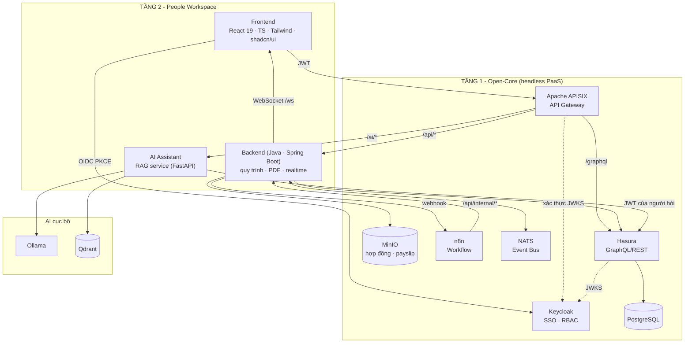
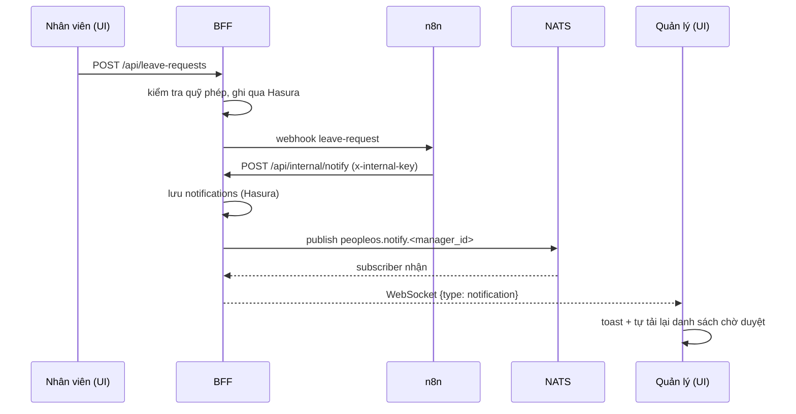
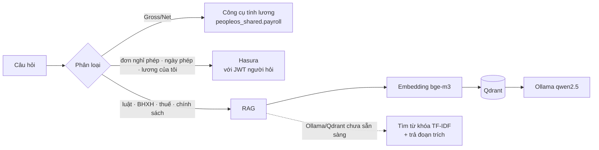

# Kiến trúc PeopleOS

PeopleOS là một **DX-OS Open-Core** chia hai tầng: **Tầng 1 (Open-Core, headless PaaS)** cung cấp các dịch vụ lõi dùng chung,
**Tầng 2 (People Workspace)** là ứng dụng nghiệp vụ nhân sự xây trên đúng các dịch vụ đó. Thêm một phân hệ mới
(tuyển dụng, KPI, đào tạo...) nghĩa là thêm một ứng dụng Tầng 2 mới, **không** dựng thêm hệ thống đăng nhập, CSDL hay bus riêng.

## 1. Sơ đồ tổng thể

## 2. Hai "thái cực" và cách giải quyết

| Thái cực | Cơ chế trong PeopleOS |
|---|---|
| **Ốc đảo dữ liệu** | Một Keycloak cho mọi ứng dụng (một danh tính); một PostgreSQL + Hasura là nguồn dữ liệu duy nhất (frontend, BFF và AI đều đọc qua Hasura, cùng bộ quyền); một MinIO cho tài liệu; một NATS cho sự kiện; một n8n cho quy trình. Ứng dụng Tầng 2 không có CSDL riêng. |
| **Phụ thuộc nhà cung cấp** | Mọi thành phần là mã nguồn mở và nói chuẩn mở: OIDC/JWT (Keycloak), GraphQL + SQL chuẩn (Hasura/PostgreSQL), S3 API (MinIO), HTTP webhook (n8n), NATS subject, Docker. Có thể thay từng thành phần mà giữ nguyên hợp đồng giao tiếp (ví dụ MinIO → Ceph/AWS S3; Keycloak → bất kỳ IdP OIDC nào; NATS → Kafka). |

## 3. Tầng 1 - Open-Core

| Dịch vụ | Vai trò | Giao diện cung cấp |
|---|---|---|
| **Keycloak** | Định danh/SSO, 4 vai trò `admin`, `hr`, `manager`, `employee` | OIDC, JWKS |
| **Apache APISIX** | Cổng duy nhất vào hệ thống; kiểm JWT, CORS, chặn `/api/internal/*` | HTTP :9080 |
| **PostgreSQL + Hasura** | Dữ liệu cấu trúc; Hasura tự sinh GraphQL, thực thi quyền hàng/cột theo vai trò | GraphQL `/graphql` |
| **MinIO** | Dữ liệu phi cấu trúc: hợp đồng, payslip, chứng từ (bucket riêng, không công khai) | S3 API |
| **n8n** | Động cơ quy trình: 4 workflow (nghỉ phép ×2, đề xuất lương, onboarding) | Webhook |
| **NATS** | Event bus: `peopleos.notify.<user_id>`, `peopleos.events.<kind>` | NATS :4222 |
| **core/shared** | Thư viện dùng chung (`peopleos_shared.payroll` - tính Gross→Net) | Python package |

### Luồng xác thực
1. Trình duyệt chuyển hướng sang Keycloak (Authorization Code + PKCE), nhận `access_token`.
2. Mọi lời gọi tới gateway mang `Authorization: Bearer`. APISIX kiểm chữ ký bằng JWKS; lỗi → 401.
3. Hasura tự xác thực lại JWT (JWKS), lấy `x-hasura-allowed-roles` từ `realm_access.roles`, `x-hasura-user-id` từ `sub`.
   Frontend gửi `x-hasura-role` để chọn vai trò hiệu lực (phải thuộc danh sách cho phép, nếu không Hasura từ chối).
4. BFF xác thực lại token (defense in depth) và kiểm tra vai trò trước khi ghi dữ liệu.

## 4. Tầng 2 - People Workspace

| Thành phần | Trách nhiệm |
|---|---|
| **Frontend** | 10 trang: Tổng quan, Hồ sơ, Hợp đồng, Bảng lương, BHXH/BHYT, Nghỉ phép, Phê duyệt, Đề xuất tăng lương, Onboarding, Trợ lý AI. Đọc dữ liệu bằng GraphQL; gọi BFF cho hành động nghiệp vụ. |
| **Backend (Java 21 · Spring Boot 3)** | Logic nghiệp vụ + kiểm tra quyền cho: nghỉ phép, đề xuất lương nhiều cấp, onboarding (tạo tài khoản Keycloak); sinh PDF và lưu MinIO; cầu nối NATS → WebSocket. |
| **RAG service** | Phân loại câu hỏi → công cụ tính lương / tra cứu Hasura bằng JWT của người hỏi / RAG trên kho tri thức. |

### Vì sao có backend riêng trong khi đã có Hasura?
Hasura xuất sắc cho đọc dữ liệu có phân quyền, nhưng các quy trình cần **kiểm tra nhiều bước, ghi nhiều bảng và gọi dịch vụ khác**
(trừ quỹ phép, chuỗi duyệt HR→Giám đốc, áp dụng mức lương mới vào hợp đồng, tạo tài khoản Keycloak, sinh PDF...).
Backend chứa phần đó; mã nguồn chia package theo từng mục (config, security, integration, leave, proposal, onboarding, document, internal... - xem `apps/people-workspace/bff/README.md`). Frontend không bao giờ ghi trực tiếp vào các bảng nghiệp vụ.

## 5. Luồng realtime

Nếu NATS hoặc n8n tạm ngừng, BFF tự chuyển sang đường dự phòng (giao trực tiếp qua WebSocket / tự soạn thông báo) để trải nghiệm không gián đoạn.

## 6. Quy trình nghiệp vụ

**Nghỉ phép / nghỉ ốm** - `pending → approved | rejected | cancelled`. Số ngày = ngày làm việc T2–T6. Phép năm kiểm tra
`quỹ phép − đã dùng − đơn đang chờ`. Chỉ quản lý trực tiếp (hoặc HR/Admin) được duyệt; không ai tự duyệt đơn của mình.
Khi duyệt phép năm, `used_days` tăng; nghỉ ốm cộng vào `sick_days_used`.

**Đề xuất tăng lương/phụ cấp** - Quản lý đề xuất (mức mới phải cao hơn hiện tại) → bước 1 **HR** → bước 2 **Giám đốc (Admin)**.
Từ chối ở bất kỳ cấp nào → kết thúc. Duyệt xong cấp cuối → tự cập nhật `contracts.base_salary` hoặc `allowance`. Lịch sử từng cấp lưu ở `approval_steps`.

**Onboarding** - HR nhập hồ sơ → BFF tạo `employees` + `contracts` + `leave_balances` (+ tài khoản Keycloak, mật khẩu tạm) → webhook n8n sinh 6 việc
trong checklist và thông báo HR/quản lý/nhân viên. Người phụ trách đánh dấu hoàn thành.

## 7. Ma trận phân quyền (RBAC)

| Dữ liệu / hành động | Employee | Manager | HR | Admin |
|---|:--:|:--:|:--:|:--:|
| Hồ sơ cá nhân | của mình | mình + nhóm | tất cả | tất cả |
| Hợp đồng, phiếu lương, BHXH | của mình | của mình | tất cả | tất cả |
| Đơn nghỉ phép: xem | của mình | mình + nhóm | tất cả | tất cả |
| Đơn nghỉ phép: duyệt | - | nhóm | tất cả | tất cả |
| Đề xuất tăng lương: tạo | - | cho nhóm | cho bất kỳ ai | cho bất kỳ ai |
| Đề xuất tăng lương: duyệt | - | - | bước HR | mọi bước |
| Onboarding / tạo nhân viên | - | - | ✓ | ✓ |
| Tải bản hợp đồng đã ký lên MinIO | - | - | ✓ | ✓ |
| Thông báo | của mình | của mình | của mình | của mình |

Ghi chú: role `admin` của Keycloak ánh xạ sang role `admin` (siêu quyền) của Hasura. Quản lý **không** xem được bảng lương của nhóm.

## 8. AI Assistant

- Các phép tính (Gross↔Net) và tra cứu dữ liệu cá nhân **không đi qua LLM** nên chính xác và tái lập được.
- Truy vấn dữ liệu nội bộ dùng chính JWT của người hỏi, nên AI không bao giờ thấy nhiều hơn quyền của họ.
- Kho tri thức (`ai/knowledge/*.md`) gồm Bộ luật Lao động 2019, Luật BHXH 2024 & chế độ liên quan, thuế TNCN 2026, chính sách nội bộ demo. Sửa file rồi gọi `POST /ai/reindex` hoặc khởi động lại `rag-service`.
- Tham số pháp lý (cập nhật 10/2026): giảm trừ 15,5 triệu / 6,2 triệu; biểu thuế 5 bậc; lương cơ sở 2,53 triệu từ 01/07/2026; lương tối thiểu vùng theo NĐ 293/2025. **Cần rà soát lại khi pháp luật thay đổi.**

## 9. Mô hình dữ liệu

`users` (id = `sub` Keycloak) ─1:1─ `employees` ─1:n─ `contracts`, `payrolls`, `insurance_records`, `leave_balances`, `leave_requests`, `onboarding_tasks`;
`employees.manager_id` tự tham chiếu; `salary_proposals` ─1:n─ `approval_steps`; `users` ─1:n─ `notifications`. Chi tiết:
`core/data/structured/hasura/migrations/default/1760000000000_init/up.sql`.

## 10. An ninh, vận hành và quản trị dữ liệu

Bổ sung 4 nhóm năng lực (chi tiết và cách kiểm chứng: [governance.md](governance.md)):

- **Quét mã độc ClamAV** mọi tệp tải lên trước khi vào MinIO.
- **GitOps + tự phục hồi + sao lưu:** CI, agent đối chiếu trạng thái với Git, healthcheck + autoheal, sao lưu PostgreSQL/MinIO định kỳ và script khôi phục/kiểm chứng.
- **Kiểm toán bất biến:** `audit_logs` append-only với chuỗi băm SHA-256; trigger ghi cả thay đổi dữ liệu trực tiếp; Admin xác minh toàn vẹn trên giao diện.
- **Phả hệ dữ liệu và dashboard điều hành:** danh mục tài sản/quan hệ dữ liệu có phân loại PII; 5 view SQL cho dashboard.

## 11. Bảo mật & giới hạn đã biết

- Không bucket MinIO nào công khai; tài liệu chỉ tải qua BFF sau khi kiểm quyền.
- `/api/internal/*` bị APISIX chặn, chỉ gọi được trong mạng Docker bằng `INTERNAL_API_KEY`.
- WebSocket `/ws` không qua plugin JWT của gateway (trình duyệt không gửi được header); BFF xác thực chữ ký token.
- Cấu hình mặc định là **môi trường demo**: Keycloak `start-dev`, HTTP không TLS, mật khẩu mẫu. Xem `docs/deployment.md` mục "Chuyển sang production".
- Số ngày nghỉ chưa trừ ngày lễ; công cụ tính thuế chưa xử lý khoản miễn thuế; dữ liệu mẫu và chính sách nội bộ là giả lập.
