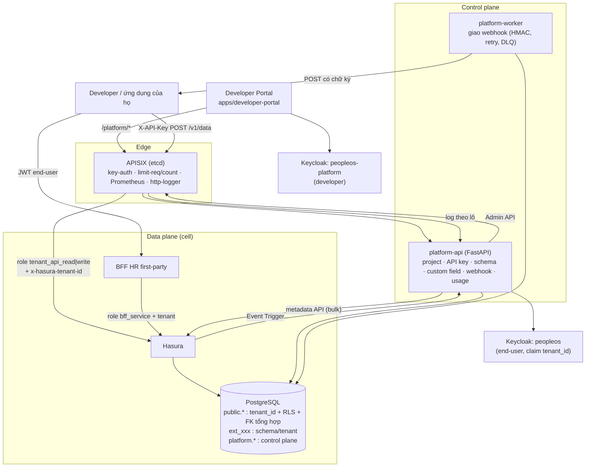

# PeopleOS HR-PaaS

PeopleOS = nền tảng nhân sự mà **developer bên thứ 3** đăng ký, lấy API key, tự thiết kế schema, nhận webhook và dựng ứng dụng HR của riêng họ.
Tài liệu này mô tả kiến trúc đã triển khai, cách chạy, mức độ kiểm chứng và các giới hạn đã biết.

## 1. Kiến trúc



### Luồng chính
| Luồng | Cách hoạt động |
|---|---|
| Tạo project | `POST /v1/projects` → saga 3 bước (schema `ext_<id>` + role owner, thừa hưởng `app_settings`, client OIDC `app-<id>`), lỗi thì bù trừ ngược |
| API key | `POST .../api-keys` → lưu `sha256` + prefix; đăng ký Consumer trong APISIX (labels: tenant, scope). Khóa chỉ hiện **một lần** |
| Gọi dữ liệu | Gateway kiểm key → đếm quota (Valkey - tương thích Redis, BSD-3) → Lua xóa mọi header `x-hasura-*` của client, đặt role/tenant **từ Consumer** → Hasura lọc theo tenant |
| Schema | Developer gửi *spec* (không phải SQL) → validate → DDL chạy bằng role `ext_<id>_owner` (chỉ có quyền trong schema của mình), RLS gắn cứng UUID tenant, FK tổng hợp tới `employees` → Hasura `bulk` (track + permission) |
| Custom field | Cột `employees.custom` (jsonb) + trigger kiểm kiểu theo khai báo của tenant; không DDL, không reload metadata |
| Webhook | Hasura Event Trigger → `/internal/hasura-events` → hàng đợi trong Postgres → worker `FOR UPDATE SKIP LOCKED`, ký `X-PeopleOS-Signature`, retry 1p/5p/30p/2h/6h, rồi dead-letter; replay từ portal |
| Đo đếm | APISIX `http-logger` (không gửi nội dung request) → `/internal/usage` → `platform.usage_daily` → tab "Sử dụng" (so với hạn mức gói) |
| End-user | Keycloak realm `peopleos`: thuộc tính `tenant_id` chỉ admin sửa được → claim `tenant_id` → Hasura `x-hasura-tenant-id` |

### Ba lớp chống rò dữ liệu giữa tenant
1. **Hasura permission:** mọi permission (sinh bằng script) có `tenant_id = X-Hasura-Tenant-Id`; BFF cũng chạy bằng role `bff_service` (không còn admin).
2. **RLS PostgreSQL:** `platform.current_tenant()` đọc `hasura.user`; fail-closed (không có tenant hoặc GUC rỗng ⇒ 0 dòng). Chỉ có hiệu lực khi Hasura kết nối bằng role **không phải superuser** (`hasura_app`).
3. **Khóa ngoại tổng hợp `(tenant_id, id)`:** không thể tạo bản ghi trỏ sang dòng của tenant khác (kể cả bảng `ext_*`), vì kiểm tra FK của PostgreSQL vốn bỏ qua RLS.

## 2. Bản đồ file

| Phần | Đường dẫn |
|---|---|
| Migration | `core/data/structured/hasura/migrations/default/` `…07_multi_tenant`, `…08_tenant_keys_views`, `…09_platform_control_plane`, `…10_tenant_composite_fks`, `…11_usage_metering` |
| Seed (đã đa tenant) | `core/data/structured/seed/generate_seed.py`, `seed.sql` |
| Sinh permission/role Hasura | `scripts/tenant-permissions.py`, `scripts/tenant-roles.py` (+ 34 file `…/metadata/…/tables/public_*.yaml`; Event Trigger PaaS được cài riêng bởi `scripts/hasura-paas-event-triggers.py`) |
| Khởi tạo Event Trigger PaaS | Service `hasura-event-triggers-init` trong `infrastructure/docker-compose.paas.yml`; dùng tên riêng cho từng bảng |
| Áp migration bằng role owner | `scripts/apply-sql-migrations.sh`, `core/data/structured/Dockerfile.migrate`, `Dockerfile.metadata`, `hasura/config.yaml` |
| Control plane | `apps/platform/platform-api/` (code + `tests/`) |
| Developer Portal | `apps/developer-portal/` |
| BFF đa tenant | `apps/people-workspace/bff/src/main/java/vn/peopleos/bff/tenant/*`, `integration/hasura/HasuraClient.java`, `config/SecurityConfig.java`, `internal/InternalController.java` |
| Keycloak | `scripts/keycloak-paas-bootstrap.py`, `core/identity/realm-peopleos-platform.json` |
| Gateway | `core/gateway/config.paas.yaml`, `core/gateway/paas/` (Lua + test), `scripts/apisix-paas-bootstrap.py` |
| Chạy cục bộ | `infrastructure/docker-compose.paas.yml`, `infrastructure/.env.paas.example` |
| Kubernetes | `infrastructure/k8s/` (xem README trong đó) |
| Kiểm thử | `scripts/test-tenant-isolation.sh` + `scripts/tests/` (SQL cô lập, bootstrap), `apps/platform/platform-api/tests/`, `.github/workflows/ci.yml` |

## 3. Chạy cục bộ (Docker Compose)

```bash
cd infrastructure
cp .env.example .env          # rồi thêm các biến trong .env.paas.example (bắt buộc: PLATFORM_SECRET_KEY)
docker compose -f docker-compose.yml -f docker-compose.paas.yml up -d --build
# Keycloak lên xong (một lần, idempotent): khai báo thuộc tính tenant_id, mapper, gán tenant cho user cũ, tạo realm developer
cd .. && python scripts/keycloak-paas-bootstrap.py
```
- Portal: <http://localhost:3100> (đăng ký tài khoản developer ở realm `peopleos-platform`). Swagger của control plane: <http://localhost:8090/docs>.
- Gọi dữ liệu bằng API key: `curl -X POST http://localhost:9080/v1/data -H "X-API-Key: pos_test_…" -H "Content-Type: application/json" -d '{"query":"{ employees(limit:5){ id full_name } }"}'`
- Migration chạy tự động qua image `cli-migrations`. **Thứ tự bắt buộc:** áp migration 007–011 + bootstrap Keycloak + đưa BFF/frontend bản mới **cùng lúc** (token cũ không có `tenant_id` sẽ bị Hasura từ chối).
- **Trước mỗi buổi demo:** `python scripts/preflight.py --paas --check-images` rồi `python scripts/smoke-paas.py` (kiểm thử đầu-cuối cả stack, gồm cô lập tenant và webhook) - xem [docs/DEMO_CHECKLIST.md](../DEMO_CHECKLIST.md).
- Seed demo: `./scripts/seed-data.sh` - **từ chối chạy** nếu DB đã có tenant của developer (vì sẽ xóa dữ liệu của họ).

## 4. Mức độ kiểm chứng

| Hạng mục | Mức kiểm chứng |
|---|---|
| Migration 007–011 (up/down, backfill), seed, sao lưu/khôi phục | Chạy trên PostgreSQL 16 thật; mô phỏng nguyên job `database` của CI |
| Cô lập SQL: RLS, audit theo tenant, view, FK chéo tenant, GUC rỗng | `scripts/tests/tenant_isolation.sql` (15 ca) |
| `platform-api` (45 test: auth, project/saga, API key, schema, custom field, webhook, usage, song song) | Chạy thật với PostgreSQL thật; Keycloak/APISIX/Hasura là **mock HTTP**. Đã thử "đột biến" để chắc test bắt được lỗi |
| Trình áp migration (owner) | Thật trên PostgreSQL: DB trống, chạy lại, baseline, rollback khi lỗi, đăng nhập `hasura_app` |
| Lua gắn tenant; script bootstrap Keycloak/APISIX | Lua 5.4 với stub; script chạy với server giả; **chưa** thử với Keycloak/APISIX thật |
| Manifest Kubernetes (30 resource) | `kubeconform --strict` (gồm CRD KEDA, CloudNativePG) + `kustomize build`; **chưa** áp lên cluster |
| Frontend (`TaxYear.tsx`, Developer Portal) | `tsc` + `vite build` |
| BFF Java | `mvn -B package`: 71 test đạt |
| Flowable engine | `mvn -B package`: 3 test đạt, gồm deploy 6 BPMN và 2 timer jobs |
| Hasura runtime (nạp metadata, migration FK tenant, JWT có claim tenant) | Đã kiểm tra cục bộ: metadata nhất quán, `/healthz` trả 200 và Hasura chấp nhận GraphQL bằng JWT Keycloak có `tenant_id` |
| PaaS Event Trigger init và giao webhook đầu-cuối | Cấu hình bootstrap đã kiểm tra; **chưa xác nhận** chạy service init và giao webhook thành công trên toàn bộ PaaS stack |
| `scripts/smoke-paas.py` (đầu-cuối: Keycloak → gateway → Hasura → webhook) | Cú pháp + hàm thuần có test (chữ ký HMAC khớp bên ký); **chưa chạy với stack thật** - đây là bài cần chạy đầu tiên |
| `preflight.py`, `make-release.py` (tar.gz tái lập được, loại bí mật) | Có test; `make-release.py` đã build 2 lần giống hệt trên repo thật |
| CI (`.github/workflows/ci.yml`) | Đã chạy tay từng lệnh; **chưa** chạy trên GitHub Actions |

## 5. Giới hạn đã biết (đọc trước khi mở cho developer bên ngoài)

1. **Lộ tên bảng giữa các tenant cùng cell:** Hasura v2 chỉ có một GraphQL schema/instance, và một request chỉ có một role nên bảng `ext_*` dùng chung role `tenant_api_*`. Dữ liệu vẫn được RLS bảo vệ, nhưng tên bảng/cột của tenant khác hiện trong introspection. Giảm thiểu: cell nhỏ, tier Dedicated (Hasura riêng), hoặc kiểm tra *inherited roles* theo phiên bản Hasura đang dùng.
2. **Gateway giữ `HASURA_ADMIN_SECRET`** để đóng vai role `tenant_api_*`. Bắt buộc NetworkPolicy chỉ cho gateway/BFF/platform-system tới Hasura (đã có trong manifest).
3. **Compose dev dùng superuser** cho Hasura ⇒ RLS bị bỏ qua (lớp 1 và 3 vẫn có hiệu lực). Production: Hasura dùng `hasura_app`, migration chạy bằng owner qua `apply-sql-migrations.sh`/Job `db-migrate`.
4. **FK tổng hợp là ràng buộc *thêm vào*** FK cũ (giữ nguyên để quan hệ trong metadata Hasura không đổi). Cần xác nhận Hasura không phàn nàn khi thấy thêm FK nhiều cột.
5. **Chống SSRF** kiểm tra DNS trước khi gửi nhưng vẫn còn khoảng hở DNS-rebinding; production nên cho worker đi qua egress proxy chỉ cho phép IP công cộng.
6. **Xóa project = xóa mềm.** Dữ liệu lõi (`public.*`) và `audit_logs` (bất biến, FK tới `tenants`) được giữ; cần chính sách lưu giữ/xóa dữ liệu cá nhân (pháp chế) trước khi đưa dữ liệu thật.
7. **Giấy phép thành phần:** Flowable sử dụng Apache-2.0; MinIO có rủi ro phát hành image upstream - xem [docs/LICENSING.md](../LICENSING.md).
8. **Chưa có:** thanh toán/billing (đo đếm sử dụng đã có), timer nền định kỳ tách riêng theo từng tenant (hiện chạy dưới tenant mặc định qua header `x-tenant-id`), role tùy biến cho end-user của developer, Organizations của Keycloak (hiện dùng thuộc tính user + client riêng mỗi project), Ingress/TLS và etcd trong manifest K8s.
9. `tenant_api_write` cho phép ghi trực tiếp các bảng nghiệp vụ lõi của chính tenant (trừ `users`, `audit_logs`) mà **không** qua logic phê duyệt của BFF; developer chịu trách nhiệm toàn vẹn nghiệp vụ của họ.
10. Control plane viết bằng Python/FastAPI (không phải Spring Boot) vì môi trường phát triển không build được Maven; schema DB và API độc lập ngôn ngữ nên chuyển sau được.

## 6. Checklist production
- [ ] Đổi toàn bộ secret mặc định; secret qua Vault/External Secrets; không commit `.env`, `backups/`.
- [ ] Hasura chạy bằng `hasura_app` qua PgBouncer (transaction mode); `platform_app` (CREATEROLE + BYPASSRLS, không superuser) cho platform-api.
- [ ] Tắt console/dev mode Hasura (đã tắt trong manifest K8s); Keycloak `start` (không `start-dev`), SMTP + `verifyEmail` cho realm developer.
- [ ] CI xanh trên GitHub Actions (đặc biệt `backend-java` build + chạy `TenantContextTest`); chạy thử luồng đầy đủ bằng `docker compose … up` (Hasura/Keycloak/APISIX thật).
- [ ] Benchmark ngưỡng tenant/cell (thời gian reload metadata, RAM Hasura) trước khi chốt kích thước cell.
