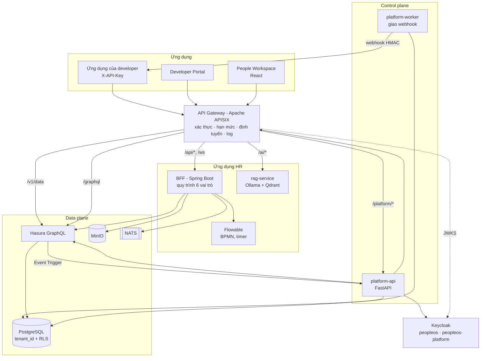

PeopleOS theo kiến trúc **DX-OS Open-Core** hai tầng: tầng 1 là nền tảng headless (PaaS), tầng 2 là ứng dụng HR first-party chạy trên chính nền tảng đó - People Workspace dùng cùng API mà developer bên ngoài dùng.

## Thành phần

| Thành phần | Công nghệ | Vai trò |
|---|---|---|
| API Gateway | Apache APISIX + etcd | Một cửa vào duy nhất; kiểm JWT/API key, giới hạn tốc độ, gắn tenant, ghi log lượt dùng |
| Xác thực | Keycloak | Realm `peopleos` (nhân viên, người dùng ứng dụng), realm `peopleos-platform` (developer) |
| Control plane | platform-api (FastAPI) + worker | Dự án, API key, schema, trường tùy chỉnh, webhook, đo lượt dùng |
| Data plane | PostgreSQL 16 + Hasura | Lõi dữ liệu nhân sự, GraphQL, permission theo vai trò và tenant |
| Ứng dụng HR | BFF Spring Boot + React | 9 quy trình nghiệp vụ, 6 vai trò |
| Quy trình | Flowable | Onboarding (BPMN), job định kỳ (hết hạn quyền tạm thời, khóa tài khoản nghỉ việc) |
| Sự kiện | NATS | Thông báo realtime, sự kiện nội bộ |
| Lưu trữ tệp | MinIO + ClamAV | Hợp đồng, phiếu lương PDF; quét mã độc khi tải lên |
| AI | Ollama + Qdrant | Trợ lý RAG chạy cục bộ |

## Đường đi của một request Data API

1. Ứng dụng gửi `POST /v1/data` kèm `X-API-Key`.
2. APISIX tìm *consumer* theo khóa (plugin `key-auth`), áp `limit-req` và `limit-count` theo gói.
3. Script Lua xóa mọi header `x-hasura-*` từ client, gắn `x-hasura-role` (`tenant_api_read` / `tenant_api_write`) và `x-hasura-tenant-id` từ nhãn của consumer.
4. Hasura áp permission (`tenant_id = X-Hasura-Tenant-Id`) và đặt biến phiên cho RLS của PostgreSQL.
5. Log lượt gọi (không chứa body) gửi theo lô về platform-api để cộng vào `usage_daily`.

## Đường đi của một sự kiện

1. Một dòng trong `employees`, `contracts`, `leave_requests` hoặc `payrolls` thay đổi.
2. Hasura Event Trigger gọi platform-api kèm bí mật dùng chung.
3. platform-api tìm webhook của tenant đăng ký loại sự kiện đó, ghi vào `webhook_deliveries`.
4. Worker lấy việc bằng `FOR UPDATE SKIP LOCKED`, ký HMAC, gửi; lỗi thì hẹn giờ thử lại; hết lượt thì `dead`.

## Mô hình triển khai

- **Docker Compose**: `infrastructure/docker-compose.yml` + `docker-compose.paas.yml` - cho phát triển và demo.
- **Kubernetes**: manifest trong `infrastructure/k8s` (Kustomize), CloudNativePG, KEDA; GitOps trong `scripts/gitops`.
- **Tier**: mặc định *pool* (nhiều tenant chung một cụm Hasura/PostgreSQL). Tách *cell* hoặc tier riêng khi cần cô lập mạnh hơn.

Chi tiết hơn: [`docs/paas/README.md`](https://github.com/Nguyen16112006/PeopleOS/blob/main/docs/paas/README.md), [`docs/ROLES_AND_WORKFLOWS.md`](https://github.com/Nguyen16112006/PeopleOS/blob/main/docs/ROLES_AND_WORKFLOWS.md).
