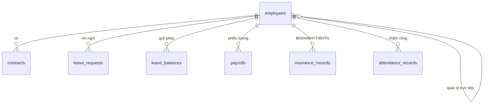

Mỗi dự án có sẵn **lõi dữ liệu nhân sự** theo nghiệp vụ Việt Nam (hợp đồng, BHXH, thuế TNCN). Bạn đọc ghi chúng qua GraphQL bằng [Data API](../platform/data-api.mdx).



## Bảng chính

### `employees` - hồ sơ nhân viên

| Cột | Kiểu | Ghi chú |
|---|---|---|
| `id` | uuid | Tự sinh |
| `employee_code` | text | **Bắt buộc**, không trùng trong dự án |
| `full_name`, `email` | text | **Bắt buộc** |
| `department`, `job_title` | text | **Bắt buộc** |
| `hire_date` | date | **Bắt buộc** |
| `manager_id` | uuid | Quản lý trực tiếp (một nhân viên khác) |
| `status` | text | `onboarding` · `active` (mặc định) · `on_leave` · `terminated` |
| `phone`, `date_of_birth`, `gender`, `address` | | Thông tin cá nhân |
| `tax_code`, `social_insurance_no`, `health_insurance_no` | text | Mã số thuế, số sổ BHXH, thẻ BHYT |
| `dependents` | int | Số người phụ thuộc (giảm trừ gia cảnh), mặc định 0 |
| `region` | int | Vùng lương tối thiểu 1 - 4, mặc định 1 |
| `custom` | jsonb | [Trường tùy chỉnh](./extending.md#trường-tùy-chỉnh) của bạn |

Quan hệ GraphQL: `manager`, `reports` (cấp dưới), `contracts`, `leave_requests`, `leave_balances`, `payrolls`, `insurance_records`.

### `contracts` - hợp đồng lao động

`employee_id`, `contract_no`, `contract_type` (`probation` · `fixed_term` · `indefinite`), `start_date`, `end_date`, `base_salary`, `allowance` (VND), `status` (`draft` · `active` mặc định · `expired` · `terminated`), `file_key` (tệp PDF trong kho lưu trữ).

### `leave_requests` - đơn nghỉ phép

`employee_id`, `leave_type` (`annual` · `sick` · `unpaid` · `personal`), `start_date`, `end_date`, `days` (> 0, bắt buộc), `reason`, `status` (`pending` · `approved` · `rejected` · `cancelled`), `approver_id`, `decision_note`, `decided_at`.

### `payrolls` - phiếu lương

Một dòng cho mỗi nhân viên mỗi tháng: `period_year`, `period_month`, `base_salary`, `allowance`, `overtime_pay`, `bonus`, `gross`, `insured_salary`, `bhxh_employee`, `bhyt_employee`, `bhtn_employee`, `taxable_income`, `personal_income_tax`, `net_salary`, `standard_days`, `paid_days`, `status` (`draft` · `paid`), `paid_at`.

### Các bảng khác

| Nhóm | Bảng |
|---|---|
| Chấm công | `attendance_records`, `timesheets` |
| Phép, bảo hiểm | `leave_balances`, `insurance_records` |
| Quy trình | `onboarding_tasks`, `offboarding_cases`, `salary_proposals`, `advance_requests`, `kpi_cycles`, `kpi_goals`, `kpi_evaluations` |
| Báo cáo (chỉ đọc) | `v_headcount_by_department`, `v_payroll_monthly`, `v_leave_summary`, `v_contracts_expiring`, `v_kpi_summary` |

Xem toàn bộ cột bằng introspection GraphQL hoặc công cụ như GraphiQL / Altair trỏ tới `/v1/data` với header `X-API-Key`.

## Quy ước

- Bạn **không gửi** `tenant_id`: gateway gắn theo API key, Hasura tự điền khi `insert`.
- Tiền là số nguyên **VND**; ngày `YYYY-MM-DD`; thời điểm ISO 8601 có múi giờ.
- Bảng lõi dùng chung cho mọi dự án nên **không đổi cấu trúc được**. Cần thêm? Xem [Mở rộng dữ liệu](./extending.md).

## Ví dụ truy vấn có quan hệ

```graphql
query NhomKinhDoanh {
  employees(where: {department: {_eq: "Kinh doanh"}, status: {_eq: "active"}}, order_by: {full_name: asc}) {
    full_name
    job_title
    manager { full_name }
    contracts(where: {status: {_eq: "active"}}) { contract_type base_salary }
    leave_requests(where: {status: {_eq: "pending"}}) { start_date end_date days }
  }
}
```
