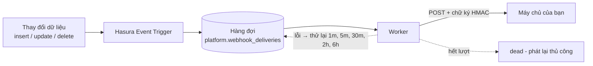

Thay vì hỏi đi hỏi lại "có gì mới không?", ứng dụng của bạn đăng ký **webhook**: PeopleOS gửi `POST` tới URL của bạn mỗi khi dữ liệu lõi của dự án thay đổi - dù thay đổi đến từ ứng dụng của bạn, từ ứng dụng khác dùng chung dự án, hay từ People Workspace.

## Loại sự kiện

Tên sự kiện có dạng `<thực thể>.<hành động>`:

| Thực thể | `created` | `updated` | `deleted` |
|---|---|---|---|
| `employee` | ✓ | ✓ | ✓ |
| `contract` | ✓ | ✓ | ✓ |
| `leave_request` | ✓ | ✓ | ✓ |
| `payroll` | ✓ | ✓ | ✓ |

Thêm sự kiện đặc biệt `ping` khi bạn bấm **Gửi thử**. Bảng dữ liệu riêng (`ext_*`) hiện **chưa** phát sự kiện.

## Bảo đảm khi giao

| Tính chất | Ý nghĩa với bạn |
|---|---|
| **Ít nhất một lần** | Một sự kiện có thể đến **hơn một lần** (ví dụ bạn xử lý xong nhưng trả lời chậm quá 10 giây). Dùng `id` sự kiện để bỏ qua bản trùng. |
| **Không bảo đảm thứ tự** | Lần thử lại có thể đến sau sự kiện mới hơn. So `created_at` hoặc đọc lại bản ghi khi cần trạng thái mới nhất. |
| **Có chữ ký** | Header `X-PeopleOS-Signature` chứng minh request đến từ PeopleOS và không bị sửa. **Luôn kiểm tra.** |
| **Cô lập** | Bạn chỉ nhận sự kiện của dự án mình. |

Payload chứa cả `object` (dòng sau thay đổi) và `previous` (dòng trước, với `updated`), nên thường bạn không cần gọi API lấy lại dữ liệu.

## Webhook hay hỏi định kỳ?

| Cần | Dùng |
|---|---|
| Phản ứng gần thời gian thực (gửi email khi đơn nghỉ được duyệt) | Webhook |
| Đồng bộ toàn bộ dữ liệu định kỳ, báo cáo cuối ngày | Truy vấn Data API theo `updated_at` |
| Cả hai | Webhook cho thay đổi + đối soát định kỳ để bắt sự kiện đã lỡ |

Làm từng bước: [Nhận webhook](../guides/webhooks.mdx). Tham chiếu: [Webhook API](../platform/webhooks.mdx).
