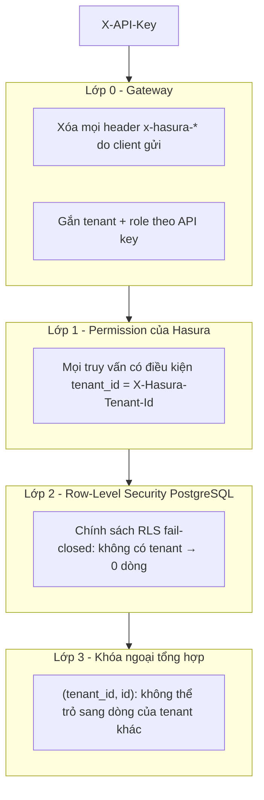

Mọi dự án nằm chung một cơ sở dữ liệu PostgreSQL (mô hình *pool*). Để dữ liệu của công ty A không bao giờ lọt sang công ty B, PeopleOS chặn ở **ba lớp độc lập** - lớp sau vẫn giữ được khi lớp trước có sai sót.

| Lớp | Chặn được |
|---|---|
| **Gateway** | Client tự khai tenant hay role khác (`x-hasura-role: admin`, `x-hasura-tenant-id: …`) |
| **Permission Hasura** | Truy vấn đọc/ghi dữ liệu ngoài tenant |
| **RLS** | Lỗi cấu hình permission, truy cập trực tiếp DB bằng role ứng dụng |
| **Khóa ngoại tổng hợp** | Ghi một dòng hợp lệ của mình nhưng tham chiếu tới nhân viên / hợp đồng của tenant khác |

Bảng dữ liệu riêng của bạn nằm trong schema `ext_<mã dự án>` do một role PostgreSQL riêng sở hữu, bật RLS với UUID tenant **gắn cứng** lúc tạo bảng.

## Các lớp bảo vệ khác

| Cơ chế | Mô tả |
|---|---|
| Bí mật được băm / mã hóa | API key lưu SHA-256; secret webhook mã hóa Fernet |
| Webhook chống SSRF | Chỉ `https`, chặn IP nội bộ / loopback / metadata cloud |
| Kiểm tra tệp | Tệp tải lên qua People Workspace được quét mã độc bằng ClamAV trước khi lưu |
| Nhật ký kiểm toán | Chuỗi băm bất biến, phát hiện được sửa/xóa |
| Giới hạn tốc độ | Theo từng API key, chống lạm dụng |

## Giới hạn đã biết

Chúng tôi công bố rõ các điểm chưa hoàn hảo để bạn đánh giá rủi ro:

1. **Tên bảng riêng có thể lộ qua introspection.** Hasura v2 dùng một GraphQL schema chung, nên *tên* bảng `ext_*` của dự án khác có thể hiện trong introspection. **Dữ liệu** vẫn được RLS bảo vệ. Đừng đặt thông tin nhạy cảm trong tên bảng hay tên cột.
2. **Môi trường dev bỏ qua RLS** vì Hasura chạy bằng superuser trong Docker Compose (lớp 1 và 3 vẫn hoạt động). Bản triển khai thật phải dùng role `hasura_app`.
3. **Chống SSRF**: phân giải tên miền, chặn IP nội bộ rồi kết nối thẳng tới đúng IP đã kiểm (giữ Host/SNI) nên không bị DNS-rebinding; egress proxy vẫn là lớp phòng thủ bổ sung nên có ở bản triển khai thật.

Danh sách đầy đủ: [`docs/paas/README.md` - Giới hạn đã biết](https://github.com/Nguyen16112006/PeopleOS/blob/main/docs/paas/README.md). Báo lỗ hổng bảo mật theo [SECURITY.md](https://github.com/Nguyen16112006/PeopleOS/blob/main/SECURITY.md), **không** mở issue công khai.
