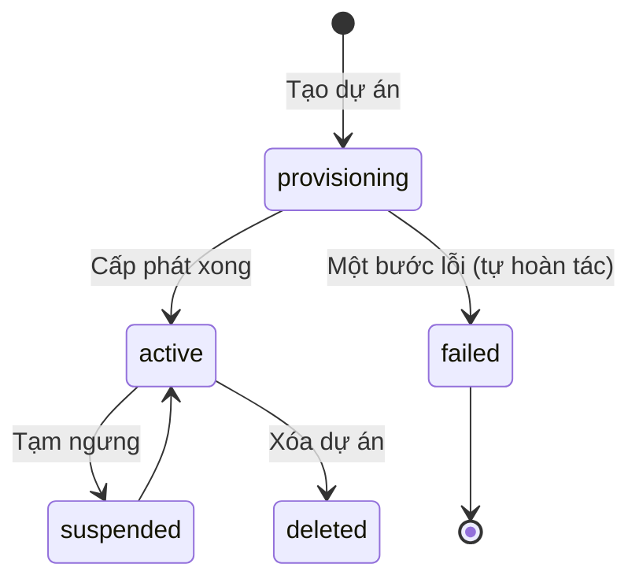

Trong PeopleOS, **dự án** (project) là đơn vị bạn làm việc hằng ngày, còn **tenant** là cách hệ thống gọi vùng dữ liệu đứng sau dự án đó. Một dự án = một tenant.

Hãy nghĩ mỗi dự án như **một công ty khách hàng** của bạn: công ty ACME có nhân viên, hợp đồng, bảng lương của riêng ACME; công ty khác dùng cùng ứng dụng của bạn sẽ là một dự án khác.

## Một dự án có gì

| Thành phần | Tên | Dùng để |
|---|---|---|
| Tenant | UUID, ví dụ `1c7e0a3b-…` | Gắn vào mọi dòng dữ liệu lõi (`tenant_id`) |
| Mã dự án | 8 ký tự, ví dụ `pk3x9q2m` | Đặt tên cho schema, client, bảng GraphQL |
| Schema riêng | `ext_pk3x9q2m` | Chứa [bảng bạn tự tạo](./extending.md) |
| Client đăng nhập | `app-pk3x9q2m` | Cho [người dùng ứng dụng](../guides/end-user-login.mdx) đăng nhập |
| API key | `pos_test_…`, `pos_live_…` | Máy chủ của bạn gọi [Data API](../platform/data-api.mdx) |
| Webhook | URL của bạn | Nhận [sự kiện](./events.md) khi dữ liệu thay đổi |

## Vòng đời

Tạo dự án chạy ba bước (tạo schema → sao chép cấu hình mặc định → tạo client đăng nhập). Bước nào lỗi thì các bước trước được **hoàn tác**, dự án chuyển `failed` và tên được nhả ra để bạn tạo lại.

## Một hay nhiều dự án?

| Tình huống | Gợi ý |
|---|---|
| Ứng dụng phục vụ **nhiều công ty** | Một dự án cho mỗi công ty khách hàng |
| Tách **thử nghiệm** và **chính thức** | Hai dự án (`ACME - dev`, `ACME`) để dữ liệu thử không lẫn dữ liệu thật |
| Một công ty, nhiều ứng dụng nhỏ | Một dự án, mỗi ứng dụng một API key riêng để thu hồi độc lập |

Số dự án tối đa phụ thuộc [gói dịch vụ](./plans.md) (gói `free`: 3).

## Xóa dự án

Xóa là **xóa mềm**: mọi API key bị thu hồi, client đăng nhập bị xóa, webhook tắt, bảng riêng gỡ khỏi GraphQL. Dữ liệu lõi và nhật ký kiểm toán (bất biến) vẫn được giữ trong cơ sở dữ liệu. Không thể khôi phục dự án đã xóa qua API.

Tham chiếu: [Project API](../platform/projects.mdx).
