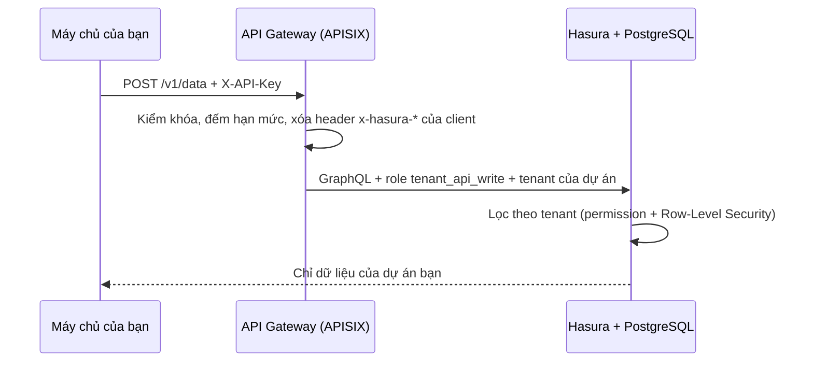

Trang này đưa bạn từ con số 0 tới lời gọi API đầu tiên. Bạn cần một máy chủ PeopleOS đang chạy: nếu chưa có, làm theo [Cài đặt môi trường](./environment-setup.mdx) trước (khoảng 10 phút với Docker).

Trong tài liệu, địa chỉ mặc định là:

| | Địa chỉ |
|---|---|
| Developer Portal | `http://localhost:3100` |
| API Gateway | `http://localhost:9080` |

## 1. Tạo tài khoản developer

Mở **Developer Portal**. Portal chuyển bạn tới trang đăng nhập Keycloak; bấm **Register** để tạo tài khoản rồi đăng nhập. Tài khoản developer nằm ở realm `peopleos-platform`, tách biệt hoàn toàn với tài khoản nhân viên.

## 2. Tạo dự án

Ở màn hình **Dự án của bạn**, nhập **Tên dự án** (ví dụ `App chấm công ACME`) rồi bấm **Tạo dự án**.

Trong vài giây, hệ thống tạo cho bạn:

- một **tenant** - vùng dữ liệu nhân sự riêng, trống, không ai khác đọc được;
- một schema `ext_<mã dự án>` để chứa [bảng riêng](./concepts/extending.md) của bạn;
- một client đăng nhập `app-<mã dự án>` cho [người dùng của ứng dụng](./guides/end-user-login.mdx).

Ghi lại **mã dự án** (8 ký tự, ví dụ `pk3x9q2m`) hiện trên trang **Tổng quan**.

## 3. Tạo API key

Vào mục **API key** của dự án:

1. **Tên gợi nhớ**: `server-dev`
2. **Quyền**: **Đọc và ghi** (để bước 5 tạo được dữ liệu)
3. **Môi trường**: **Thử nghiệm (sandbox)**
4. Bấm **Tạo khóa** và **sao chép ngay** - khóa đầy đủ chỉ hiện một lần.

```bash
export PEOPLEOS_API_KEY="pos_test_1a2b3c4d_…"
```

:::danger
API key là bí mật như mật khẩu. Chỉ dùng trên **máy chủ** của bạn, không nhúng vào ứng dụng web hay mobile, không commit lên Git.
:::

## 4. Gọi API đầu tiên

Mọi dữ liệu đi qua một endpoint GraphQL duy nhất: `POST /v1/data`.

<Tabs groupId="lang">
<TabItem value="bash" label="cURL" default>

```bash
curl -s -X POST http://localhost:9080/v1/data \
  -H "X-API-Key: $PEOPLEOS_API_KEY" \
  -H "Content-Type: application/json" \
  -d '{"query":"{ employees(limit: 5) { id full_name job_title } }"}'
```

</TabItem>
<TabItem value="js" label="Node.js">

```js title="hello.mjs"
const res = await fetch('http://localhost:9080/v1/data', {
  method: 'POST',
  headers: {'X-API-Key': process.env.PEOPLEOS_API_KEY, 'Content-Type': 'application/json'},
  body: JSON.stringify({query: '{ employees(limit: 5) { id full_name job_title } }'}),
});
console.log(JSON.stringify(await res.json(), null, 2));
```

```bash
node hello.mjs
```

</TabItem>
<TabItem value="py" label="Python">

```python title="hello.py"
import os, requests

r = requests.post(
    "http://localhost:9080/v1/data",
    headers={"X-API-Key": os.environ["PEOPLEOS_API_KEY"]},
    json={"query": "{ employees(limit: 5) { id full_name job_title } }"},
)
print(r.json())
```

</TabItem>
</Tabs>

Dự án mới chưa có nhân viên nào, nên bạn sẽ nhận:

```json
{"data": {"employees": []}}
```

Đó là đúng: tenant của bạn **trống và tách biệt** với dữ liệu demo hay của dự án khác.

## 5. Thêm nhân viên đầu tiên

```bash
curl -s -X POST http://localhost:9080/v1/data \
  -H "X-API-Key: $PEOPLEOS_API_KEY" -H "Content-Type: application/json" \
  -d '{
    "query": "mutation($e: employees_insert_input!) { insert_employees_one(object: $e) { id employee_code full_name } }",
    "variables": {"e": {
      "employee_code": "NV001", "full_name": "Lê Thị Mai", "email": "mai.le@acme.vn",
      "department": "Kinh doanh", "job_title": "Chuyên viên", "hire_date": "2026-12-01"
    }}
  }'
```

```json title="Phản hồi"
{"data": {"insert_employees_one": {"id": "e81b…", "employee_code": "NV001", "full_name": "Lê Thị Mai"}}}
```

Chạy lại truy vấn ở bước 4, bạn sẽ thấy Mai. Bạn không cần gửi `tenant_id`: gateway tự gắn theo API key.

## Bạn vừa làm gì?



## Tiếp theo

- **Hiểu nền tảng:** [Dự án & tenant](./concepts/projects.md) → [API key](./concepts/api-keys.md) → [Mô hình dữ liệu](./concepts/data-model.md).
- **Làm một ứng dụng hoàn chỉnh:** [Xây ứng dụng đầu tiên](./guides/first-app.mdx) - danh bạ nhân viên và đơn nghỉ phép, có webhook.
- **Tra cứu:** [Data API](./platform/data-api.mdx), [Platform API](./platform/overview.mdx).
