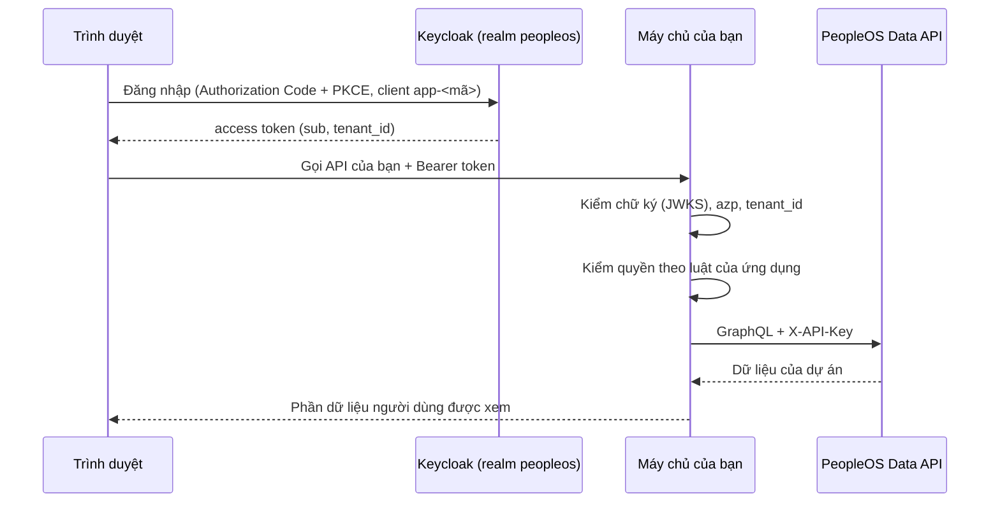

Mỗi dự án có sẵn một **client OIDC** tên `app-<mã dự án>` trong realm `peopleos` của Keycloak. Người dùng bạn tạo cho dự án đăng nhập qua client này; token của họ mang claim **`tenant_id`** = ID dự án, nên bạn luôn biết họ thuộc dự án nào.

## Mô hình khuyến nghị



Trình duyệt **không** cầm API key. Máy chủ của bạn xác thực người dùng bằng token, quyết định họ được làm gì, rồi mới gọi Data API.

:::note Vì sao không gọi thẳng `/graphql` bằng token người dùng?
Tài khoản tạo qua portal chưa được gán vai trò nghiệp vụ (`employee`, `manager`…), và PeopleOS chưa hỗ trợ vai trò tùy biến cho người dùng của developer. Vì vậy phân quyền nằm ở máy chủ của bạn. Đây là giới hạn hiện tại, được ghi trong [giới hạn đã biết](../concepts/isolation.md#giới-hạn-đã-biết).
:::

## 1. Khai báo redirect URI

Client chỉ chấp nhận đăng nhập về các **redirect URI** khai báo khi tạo dự án. Form trên portal chỉ có tên dự án, nên hãy tạo dự án bằng API khi cần đăng nhập người dùng:

```bash
curl -s -X POST http://localhost:9080/platform/v1/projects \
  -H "Authorization: Bearer $DEV_TOKEN" -H 'Content-Type: application/json' \
  -d '{"name":"Nghỉ phép ACME","redirect_uris":["http://localhost:5173/callback","https://app.acme.vn/callback"]}'
```

Ghi lại `id` (chính là `tenant_id`) và `short_id` trong phản hồi.

## 2. Tạo tài khoản người dùng

Portal → **Người dùng ứng dụng**, hoặc:

```bash
curl -s -X POST http://localhost:9080/platform/v1/projects/$PROJECT_ID/users \
  -H "Authorization: Bearer $DEV_TOKEN" -H 'Content-Type: application/json' \
  -d '{"username":"mai.le","email":"mai@acme.vn","password":"TamThoi@2026"}'
```

Tên đăng nhập thật có tiền tố mã dự án: `pk3x9q2m.mai.le`. Mật khẩu là **tạm thời** - Keycloak bắt đổi ở lần đăng nhập đầu.

Nối tài khoản với hồ sơ nhân viên bằng cách lưu `sub` của người dùng vào một [trường tùy chỉnh](../concepts/extending.md#trường-tùy-chỉnh) (ví dụ `login_sub`) hoặc bảng riêng của bạn.

## 3. Đăng nhập ở frontend

Thông số OIDC:

| Tham số | Giá trị |
|---|---|
| Issuer | `http://localhost:8080/realms/peopleos` |
| Client ID | `app-<mã dự án>` (public client, **PKCE S256** bắt buộc) |
| Discovery | `http://localhost:8080/realms/peopleos/.well-known/openid-configuration` |
| Scope | `openid profile email` |

Ví dụ với thư viện `oidc-client-ts`:

```js title="auth.js"
import {UserManager} from 'oidc-client-ts';

export const auth = new UserManager({
  authority: 'http://localhost:8080/realms/peopleos',
  client_id: 'app-pk3x9q2m',
  redirect_uri: 'http://localhost:5173/callback',
  response_type: 'code',          // Authorization Code + PKCE (thư viện tự tạo code_verifier)
  scope: 'openid profile email',
});

// Nút "Đăng nhập":   await auth.signinRedirect();
// Trang /callback:   const user = await auth.signinRedirectCallback();
// Gọi API của bạn:   fetch('/api/leaves', {headers: {Authorization: `Bearer ${user.access_token}`}})
```

## 4. Kiểm token ở máy chủ

```js title="verify.js"
import {createRemoteJWKSet, jwtVerify} from 'jose';

const ISSUER = 'http://localhost:8080/realms/peopleos';
const JWKS = createRemoteJWKSet(new URL(`${ISSUER}/protocol/openid-connect/certs`));

export async function currentUser(req) {
  const token = req.headers.authorization?.replace(/^Bearer /, '');
  if (!token) throw Object.assign(new Error('Chưa đăng nhập'), {status: 401});
  const {payload} = await jwtVerify(token, JWKS, {issuer: ISSUER});
  if (payload.azp !== 'app-pk3x9q2m') throw Object.assign(new Error('Sai ứng dụng'), {status: 401});
  if (payload.tenant_id !== process.env.PEOPLEOS_PROJECT_ID) throw Object.assign(new Error('Sai dự án'), {status: 403});
  return {sub: payload.sub, username: payload.preferred_username};
}
```

Ba kiểm tra đều cần thiết: **chữ ký** (token thật), **`azp`** (cấp cho đúng ứng dụng của bạn, không phải ứng dụng khác cùng realm), **`tenant_id`** (người của đúng dự án).

## 5. Gọi dữ liệu thay mặt người dùng

```js
app.get('/api/my-leaves', async (req, res) => {
  const me = await currentUser(req);
  const {employees} = await gql(
    `query($sub: String!) {
       employees(where: {custom: {_contains: {login_sub: $sub}}}) {
         full_name
         leave_requests(order_by: {start_date: desc}) { start_date end_date days status }
       }
     }`, {sub: me.sub});
  res.json(employees[0] ?? null);
});
```

Máy chủ chỉ trả đúng dữ liệu của người đang đăng nhập - đó là phần phân quyền do ứng dụng của bạn đảm nhận.
