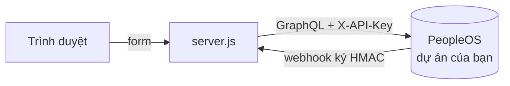

Trong bài này bạn xây **"Nghỉ phép ACME"**: một trang web liệt kê nhân viên, cho phép tạo và duyệt đơn nghỉ phép, đồng thời nhận webhook mỗi khi đơn thay đổi. Toàn bộ chỉ dùng **Node.js 18+**, không cần thư viện ngoài.

Bạn sẽ học:

- gọi Data API bằng GraphQL từ máy chủ;
- ghi dữ liệu có quan hệ (nhân viên ↔ quản lý ↔ đơn nghỉ);
- nhận và xác minh webhook.

:::info Trước khi bắt đầu
Hoàn thành [Bắt đầu nhanh](../getting-started.mdx): bạn đã có một **dự án** và một API key quyền **Đọc và ghi**.
:::

## 1. Tạo thư mục dự án

```bash
mkdir nghi-phep-acme && cd nghi-phep-acme
npm init -y
npm pkg set type=module
```

Tạo file `.env` (Node 20.6+ đọc trực tiếp bằng `--env-file`):

```ini title=".env"
PEOPLEOS_URL=http://localhost:9080/v1/data
PEOPLEOS_API_KEY=pos_test_1a2b3c4d_…
PEOPLEOS_WEBHOOK_SECRET=
PORT=4000
```

## 2. Viết client gọi PeopleOS

Mọi lời gọi đi qua một hàm nhỏ:

```js title="peopleos.js"
export async function gql(query, variables = {}) {
  const res = await fetch(process.env.PEOPLEOS_URL, {
    method: 'POST',
    headers: {'X-API-Key': process.env.PEOPLEOS_API_KEY, 'Content-Type': 'application/json'},
    body: JSON.stringify({query, variables}),
  });
  if (res.status === 429) throw new Error('Vượt hạn mức gọi API, thử lại sau');
  if (!res.ok) throw new Error(`PeopleOS trả HTTP ${res.status}`);
  const {data, errors} = await res.json();
  if (errors) throw new Error(errors.map((e) => e.message).join('; '));
  return data;
}
```

## 3. Nạp dữ liệu mẫu

Dự án mới trống. Script sau tạo một quản lý và hai nhân viên báo cáo cho người đó - nhờ **insert lồng nhau** của GraphQL, chỉ cần một request:

```js title="seed.js"
import {gql} from './peopleos.js';

const data = await gql(`
  mutation Seed($m: employees_insert_input!) {
    insert_employees_one(object: $m) {
      full_name
      reports { full_name }
    }
  }`, {
  m: {
    employee_code: 'QL01', full_name: 'Trần Minh Quân', email: 'quan@acme.vn',
    department: 'Kinh doanh', job_title: 'Trưởng phòng', hire_date: '2024-03-01',
    reports: {
      data: [
        {employee_code: 'NV01', full_name: 'Lê Thị Mai', email: 'mai@acme.vn',
         department: 'Kinh doanh', job_title: 'Chuyên viên', hire_date: '2025-06-01'},
        {employee_code: 'NV02', full_name: 'Phạm Văn Hưng', email: 'hung@acme.vn',
         department: 'Kinh doanh', job_title: 'Chuyên viên', hire_date: '2025-09-15'},
      ],
    },
  },
});
console.log(JSON.stringify(data, null, 2));
```

```bash
node --env-file=.env seed.js
```

```json title="Kết quả"
{
  "insert_employees_one": {
    "full_name": "Trần Minh Quân",
    "reports": [{"full_name": "Lê Thị Mai"}, {"full_name": "Phạm Văn Hưng"}]
  }
}
```

:::tip
`reports` là quan hệ ngược của `manager_id`. Hasura tự điền `manager_id` của hai nhân viên bằng `id` của Quân, và tự gắn `tenant_id` của dự án cho cả ba dòng.
:::

## 4. Làm máy chủ web

```js title="server.js"
import http from 'node:http';
import crypto from 'node:crypto';
import {gql} from './peopleos.js';

const esc = (s) => String(s ?? '').replace(/[&<>"']/g, (c) => `&#${c.charCodeAt(0)};`);

// Đếm ngày làm việc (thứ 2 - thứ 6) trong khoảng ngày.
function workingDays(from, to) {
  let n = 0;
  for (let d = new Date(from); d <= new Date(to); d.setUTCDate(d.getUTCDate() + 1)) {
    const w = d.getUTCDay();
    if (w !== 0 && w !== 6) n++;
  }
  return n;
}

async function page() {
  const {employees, leave_requests} = await gql(`{
    employees(order_by: {employee_code: asc}) { id employee_code full_name manager { full_name } }
    leave_requests(order_by: {created_at: desc}, limit: 20) {
      id leave_type start_date end_date days status employee { full_name }
    }
  }`);
  const options = employees.map((e) => `<option value="${e.id}">${esc(e.full_name)}</option>`).join('');
  const rows = leave_requests.map((r) => `
    <tr><td>${esc(r.employee.full_name)}</td><td>${r.start_date} → ${r.end_date}</td><td>${r.days}</td>
        <td>${r.status}</td>
        <td>${r.status === 'pending'
          ? `<form method="post" action="/leave/${r.id}/approve"><button>Duyệt</button></form>` : ''}</td></tr>`).join('');
  return `<!doctype html><meta charset="utf-8"><title>Nghỉ phép ACME</title>
    <h1>Nghỉ phép ACME</h1>
    <h2>Nhân viên</h2>
    <ul>${employees.map((e) => `<li>${esc(e.employee_code)} - ${esc(e.full_name)}
      ${e.manager ? `(QL: ${esc(e.manager.full_name)})` : ''}</li>`).join('')}</ul>
    <h2>Tạo đơn nghỉ phép</h2>
    <form method="post" action="/leave">
      <select name="employee_id">${options}</select>
      <input type="date" name="start_date" required> → <input type="date" name="end_date" required>
      <input name="reason" placeholder="Lý do"> <button>Gửi đơn</button>
    </form>
    <h2>Đơn gần đây</h2>
    <table border="1" cellpadding="6"><tr><th>Nhân viên</th><th>Thời gian</th><th>Ngày</th><th>Trạng thái</th><th></th></tr>${rows}</table>`;
}

async function readBody(req) {
  const chunks = [];
  for await (const c of req) chunks.push(c);
  return Buffer.concat(chunks);
}

const server = http.createServer(async (req, res) => {
  try {
    if (req.method === 'GET' && req.url === '/') {
      res.writeHead(200, {'Content-Type': 'text/html; charset=utf-8'});
      return res.end(await page());
    }

    if (req.method === 'POST' && req.url === '/leave') {
      const f = Object.fromEntries(new URLSearchParams((await readBody(req)).toString()));
      const days = workingDays(f.start_date, f.end_date);
      if (days < 1) throw new Error('Khoảng ngày không có ngày làm việc');
      await gql(`mutation($o: leave_requests_insert_input!) { insert_leave_requests_one(object: $o) { id } }`, {
        o: {employee_id: f.employee_id, leave_type: 'annual', start_date: f.start_date,
            end_date: f.end_date, days, reason: f.reason || null},
      });
      res.writeHead(303, {Location: '/'});
      return res.end();
    }

    const approve = req.url.match(/^\/leave\/([0-9a-f-]{36})\/approve$/);
    if (req.method === 'POST' && approve) {
      await gql(`mutation($id: uuid!, $at: timestamptz!) {
        update_leave_requests_by_pk(pk_columns: {id: $id}, _set: {status: "approved", decided_at: $at}) { id }
      }`, {id: approve[1], at: new Date().toISOString()});
      res.writeHead(303, {Location: '/'});
      return res.end();
    }

    if (req.method === 'POST' && req.url === '/hooks/peopleos') {
      return handleWebhook(req, res, await readBody(req));
    }

    res.writeHead(404).end('Không tìm thấy');
  } catch (err) {
    res.writeHead(500, {'Content-Type': 'text/plain; charset=utf-8'}).end(`Lỗi: ${err.message}`);
  }
});

// --- Webhook: bước 5 -------------------------------------------------------
const seen = new Set(); // demo; ứng dụng thật lưu id sự kiện vào DB

function handleWebhook(req, res, raw) {
  const header = req.headers['x-peopleos-signature'] ?? '';
  const {t, v1} = Object.fromEntries(header.split(',').map((p) => p.split('=')));
  const expected = crypto.createHmac('sha256', process.env.PEOPLEOS_WEBHOOK_SECRET)
    .update(`${t}.${raw}`).digest('hex');
  const ok = v1?.length === expected.length &&
    crypto.timingSafeEqual(Buffer.from(v1), Buffer.from(expected)) &&
    Math.abs(Date.now() / 1000 - Number(t)) < 300;
  if (!ok) return res.writeHead(401).end();

  const event = JSON.parse(raw);
  if (!seen.has(event.id)) {
    seen.add(event.id);
    const o = event.data.object ?? {};
    console.log(`[webhook] ${event.type}`, o.id ?? '', o.status ?? '');
  }
  res.writeHead(204).end();
}

server.listen(process.env.PORT, () => console.log(`Mở http://localhost:${process.env.PORT}`));
```

```bash
node --env-file=.env server.js
```

Mở `http://localhost:4000`, tạo một đơn nghỉ phép rồi bấm **Duyệt**. Dữ liệu được lưu trong dự án PeopleOS của bạn, nên ứng dụng khác dùng cùng dự án (hoặc webhook) đều thấy ngay.

:::caution Đây là bản demo
Trang này không có đăng nhập và ai cũng bấm **Duyệt** được. Ứng dụng thật cần xác thực người dùng ([Đăng nhập người dùng ứng dụng](./end-user-login.mdx)) và tự kiểm tra ai được duyệt đơn của ai - khóa `write` không làm việc đó thay bạn.
:::

## 5. Nhận webhook

Worker của PeopleOS chạy trong Docker và mặc định chỉ gửi tới `https` có IP công khai. Khi phát triển trên máy, có hai cách:

<Tabs>
<TabItem value="local" label="Cho phép HTTP nội bộ (máy dev)" default>

Trong `infrastructure/.env` của PeopleOS, bật:

```ini
ALLOW_HTTP_WEBHOOKS=true
ALLOW_PRIVATE_WEBHOOKS=true
```

rồi khởi động lại `platform-api` và `platform-worker`. Dùng URL `http://host.docker.internal:4000/hooks/peopleos` (container worker đã được khai báo `host.docker.internal` trỏ về máy bạn, kể cả trên Linux).

</TabItem>
<TabItem value="tunnel" label="Dùng tunnel HTTPS">

Chạy một dịch vụ tunnel (ví dụ `cloudflared tunnel --url http://localhost:4000`) để có URL `https://…` công khai, rồi dùng `https://<tên-miền-tunnel>/hooks/peopleos`.

</TabItem>
</Tabs>

Trên portal, vào **Webhook** → **Thêm webhook**, dán URL, tích nhóm **Đơn nghỉ phép**. Sao chép **secret** (`whsec_…`) vào `PEOPLEOS_WEBHOOK_SECRET` trong `.env` rồi chạy lại `server.js`.

Bấm **Gửi thử**, sau đó duyệt một đơn trên trang web. Terminal sẽ in:

```text
[webhook] ping
[webhook] leave_request.updated 6f1c… approved
```

Nhật ký gửi sự kiện trên portal chuyển sang **delivered** với mã phản hồi `204`.

## Bạn đã làm được



## Tiếp theo

- Thêm bảng **đổi ca** riêng cho ứng dụng: [Dữ liệu riêng cho ứng dụng](./custom-data.mdx).
- Cho nhân viên đăng nhập bằng tài khoản riêng: [Đăng nhập người dùng ứng dụng](./end-user-login.mdx).
- Chuẩn bị chạy thật: [Lên môi trường chính thức](./go-live.md).
